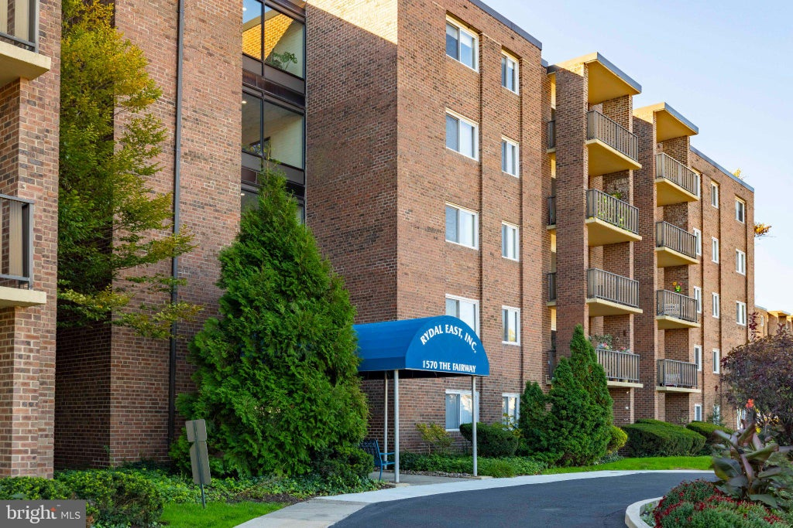

# Rydal East Inc. — Residential Cooperative Website

Official website for **Rydal East Inc.** (1570 & 1610 The Fairway, Jenkintown / Rydal, PA 19046), a premier residential housing cooperative in Abington Township, Montgomery County, PA.



## Overview

Rydal East Inc. offers all-inclusive suburban cooperative living just 25 minutes from Center City Philadelphia. One predictable monthly fee covers real estate/property taxes, electricity, air conditioning, radiant heating, water, sewer, trash, basic cable, seasonal outdoor saltwater pool, off-street parking, and complete building maintenance.

## Key Features

- **Full-Width Light Editorial Design**: Frosted glass panels (`backdrop-filter: blur(16px)`), warm alabaster tones, luminous hairline borders, and fluid responsive containers.
- **Architectural Banner**: Modular stepped pill cluster showcasing authentic exterior property photography, covered balcony verandas, and saltwater pool grounds.
- **Interactive Floor Plan Switcher**: Explore 1-Bedroom, 2-Bedroom, and 3-Bedroom residence specifications, square footages, fee estimates, and photo galleries.
- **Interactive Fee Comparison Tool**: Real-time slider calculator comparing traditional suburban home/condo ownership expenses against Rydal East's all-inclusive monthly fee.
- **Authentic Photo Lightbox Modal**: High-resolution gallery viewer with thumbnail strip and keyboard navigation.
- **Curated Bento Grid**: Amenities showcase covering the saltwater pool, sunlit atrium lounge, community reception salon, and on-floor laundry/storage.
- **Neighborhood Directory & Interactive Transit Map**: Walkable access to Baederwood Shopping Center (Whole Foods Market), SEPTA Regional Rail (Rydal & Noble stations), and Jefferson Abington Hospital.
- **Prospective Buyer FAQ Accordion**: Comprehensive guide to co-op share purchases, cash requirement, board approval process, capital contributions, and pet policies.
- **Private Showing Booking Modal**: Interactive tour request form with validation and board purchase acknowledgment.

## Tech Stack

- **HTML5**: Semantic, accessible markup (ARIA attributes, modal dialogs, tablists).
- **CSS3**: Modern CSS custom properties, CSS Grid, Flexbox, glassmorphic filters, and smooth cubic-bezier transitions.
- **Vanilla JavaScript**: Zero dependencies, lightweight event delegation, reactive calculator math, and accessible modal state management.
- **Typography**: [Marcellus](https://fonts.google.com/specimen/Marcellus) (Serif headings) and [Plus Jakarta Sans](https://fonts.google.com/specimen/Plus+Jakarta+Sans) (Modern UI & body text).

## Structure

```text
rydal-east-website/
├── index.html           # Main semantic web application
├── styles.css           # Full-width light design system & glassmorphism
├── app.js               # Reactive logic (tabs, calculator, lightbox, modal)
├── README.md            # Repository documentation
└── assets/
    └── images/          # Authentic Bright MLS architectural photography
```

## Local Development

Open `index.html` in any modern web browser or serve via any static file server:

```bash
# Python
python -m http.server 8000

# Node.js
npx serve .
```

---
&copy; 2026 Rydal East Inc. Equal Housing Opportunity.
